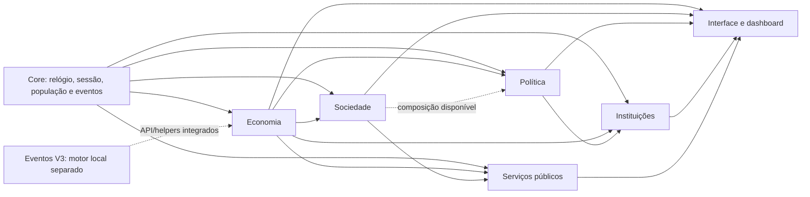
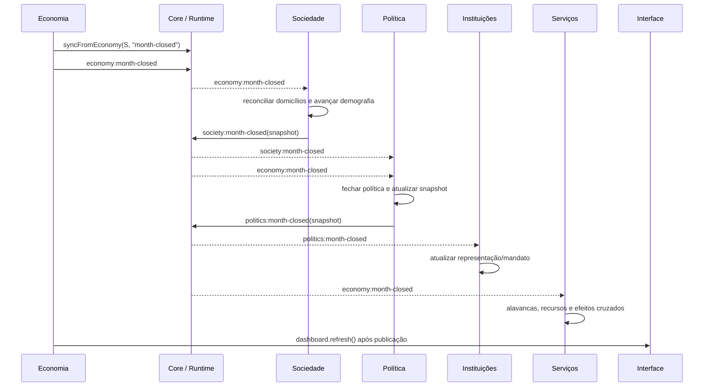

# Arquitetura geral do Vilarejo — estado integrado da branch

**Base:** `main` (`179b07c`) + alterações isoladas na branch `integracao-governo-1.0`. Este documento descreve o código que está na branch, não uma arquitetura aspiracional.

## Componentes e propriedade de estado

| Componente | ID Runtime | Dono do estado e responsabilidade |
|---|---|---|
| Core | `core` | Sessão, relógio, diretório de população, registro de módulos, snapshots e barramento. |
| Eventos V3 | — | Catálogo e estado próprios de eventos; integração com o jogo por `EventosV3` e helpers. Não assina tópicos do Core. |
| Economia | `economia` | Estado `S`, domicílios econômicos, trabalho, produção, preços, crédito, caixa, contas e auditorias. |
| Sociedade | `sociedade` | Cadastro individual/demográfico, mobilidade, cultura e qualidade de vida; sincroniza grupos econômicos. |
| Política | `politica` | Grupos de interesse, composição, influência e impactos políticos. |
| Instituições | `instituicoes` | Câmara, assentos, bancadas, coalizão, oposição e mandatos, derivadas da Política. |
| Serviços | `servicos` + sete IDs setoriais | Indicadores e recursos de cenário, alavancas e efeitos entre áreas. |
| Interface | — | Renderização dos snapshots, navegação, gráficos e painéis; não é dona dos estados dos módulos. |

Cada módulo mantém seus dados. Leitura cruzada se dá por snapshot ou payload de evento; não se deve escrever diretamente no objeto interno de outro domínio. As exceções de dados compartilhados são interfaces públicas delimitadas: a Economia sincroniza grupos no Core e a Sociedade reconcilia uma cópia demográfica desses grupos.

## Dependências verificadas

As setas sólidas indicam requisitos de registro/Runtime observados. A linha pontilhada de Sociedade para Política é uma fonte de composição opcional; nomes como `energy` dentro de `services.dependencies` são relações conceituais internas, não módulos Runtime adicionais. Eventos V3 é um motor local integrado por globals e funções auxiliares, não pelo barramento.

## Ordem de carga no navegador

A ordem efetiva no `index.html`, protegida por teste estrutural, é:

1. `src/core/vilarejo_core.js`
2. `src/events/eventos_v3.js`
3. `src/economy/vilarejo_economy.js`
4. `src/society/vilarejo_society.js`
5. `src/politics/vilarejo_politics.js`
6. `src/institutions/vilarejo_institutions.js`
7. `src/services/vilarejo_services.js`
8. `src/ui/dashboard.js`

A Economia cria e expõe o Runtime se `VilarejoCore` estiver presente. Sociedade exige Core e Economia; Política exige Core e Economia; Instituições exige Core, Economia e Política; Serviços exige Core, Economia e Sociedade e registra os sete domínios setoriais antes do agregador. O registro automático depende dos globals e dos módulos prévios; a mera presença de um `<script>` não é garantia de sucesso, então o smoke test de integração exercita a ordem e o contrato.

## Fluxo mensal por eventos

O Core fornece o barramento; os listeners são instalados pelos módulos. A ordem de carregamento antecede o fluxo porque os adaptadores registram listeners ao inicializar. A integração combinada testa uma entrega repetida do mesmo mês: Sociedade e Serviços não avançam/publicam novamente; Política e Instituições também protegem o fechamento do mês.

## Limites de domínio

### Economia e finanças

As regras financeiras pertencem à Economia. O snapshot de fechamento contém `monthNumber`, dia/ano, população, resumo de contas nacionais, resultado fiscal nominal e `gameOver`. A integração não cria lançamentos de gastos públicos para as alavancas de Serviços. A suíte de 61 cenários econômicos internos, stress tests e auditorias continua passando.

### Sociedade e população

A Sociedade mantém pessoas em estado próprio e deriva grupos da Economia. O contrato agora preserva `migrant: true` no grupo sincronizado, identifica o adulto como nascido fora e valida a unicidade de IDs de domicílios e pessoas antes de mutações relevantes. O nascimento, envelhecimento e mortalidade ainda não reescrevem a composição econômica nem o mercado de trabalho.

### Política e Instituições

Política contém dez grupos de interesse; suas medidas de composição podem ser indisponíveis/estimadas e os grupos podem se sobrepor. Instituições distribui assentos entre grupos, sem converter essas bancadas em contagem exclusiva de eleitores. Não há votação legislativa ou sistema completo de eleições implementado.

### Serviços públicos

`src/services/vilarejo_services.js` contém sete áreas lógicas, registradas separadamente no Runtime, mas coordenadas por um módulo agregado. Isso mantém a separação de domínio sem inventar sete arquivos ou subsistemas vazios. Os valores iniciais são cenários normalizados; `assumptions.budgetLinked` é `false`. Projetos, folha, compras, obras físicas, custeio e uso de caixa não estão conectados.

### Interface e servidor

O dashboard lê snapshots e globals públicos, troca de painel e chama renderizadores de módulo. Atualiza após navegação e fechamento mensal. O servidor HTTP é estático: GET/HEAD, `index.html` e `style.css` na raiz, `src/` e `public/`; não é uma API nem executa autenticação/TLS.

## Ciclo de vida e persistência

O Core expõe `game:reset`; adaptadores recriam seus estados. A Economia sincroniza a nova partida e pode publicar `game:initialized`. IDs de eventos e snapshots são copiados por serialização JSON. Não há persistência completa do estado da partida; Eventos V3 serializa apenas o estado do próprio motor.

## Verificação

- `npm run build`: valida sintaxe dos módulos e testes ativos.
- `npm test`: runner econômico/estrutural, suítes de domínio, integração real do Runtime e smoke test HTTP.
- `.github/workflows/ci.yml`: matriz Node 18 e 22 em push/PR.

Para contratos por módulo, veja [`docs/modules/`](../modules/); para escolhas e limitações, veja [ADR-001](../decisions/ADR-001-integracao-sobre-main.md).
