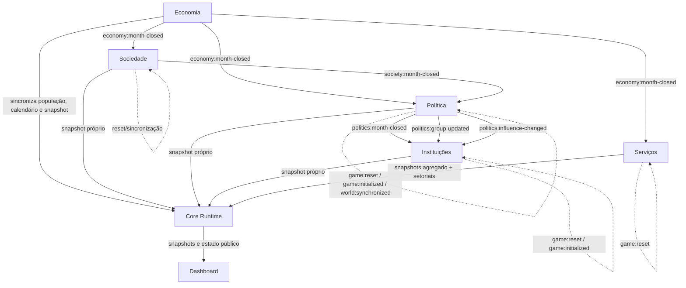
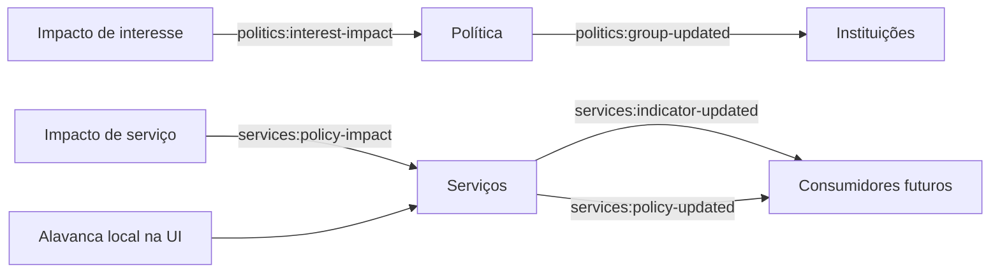

# Fluxo de eventos do Vilarejo

## Fechamento mensal

No código, o produtor `economy:month-closed` primeiro chama `syncFromEconomy`; os módulos de domínio escutam esse evento. Sociedade então publica o fechamento social; Política produz seu fechamento e Instituições o consome. Serviços evolui por fechamento econômico. Após o despacho, a Economia chama `VilarejoDashboard.refresh()` se a interface já estiver carregada.

## Eventos de mudança de política

A interface encaminha alavancas de Serviços ao adaptador público do módulo; nenhum evento cria um lançamento no razão econômico.

## Motor de Eventos V3

`src/events/eventos_v3.js` mantém catálogo/estado próprios e exporta `EventosV3`. A Economia injeta estado e funções helper; não foram encontrados `runtime.events.on` nem `runtime.publish` dentro do motor V3. Ele não deve ser confundido com o barramento genérico do Core.

## Propriedades do barramento

O Core encapsula eventos com tópico, source, dia e payload serializável, mantém histórico limitado e isola falha de listener dos demais. As assinaturas retornam uma função para cancelar. O namespace de evento deve refletir o domínio emissor; payload deve ser simples e não conter referências circulares, funções ou elementos DOM.
